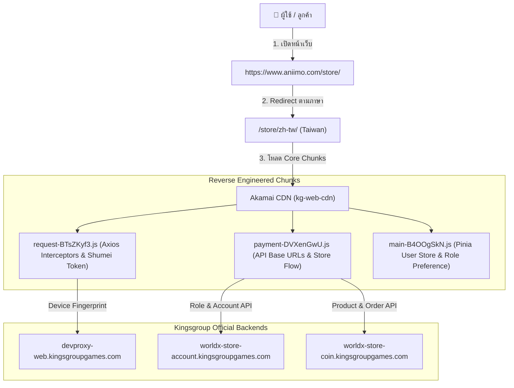
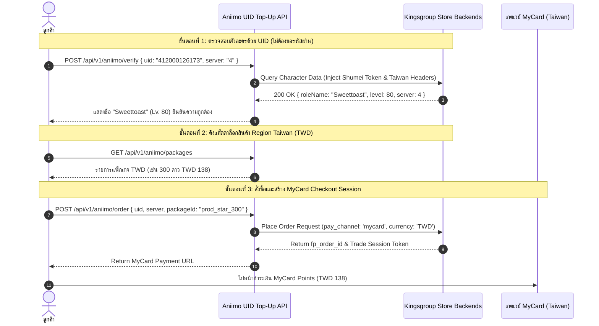

# 🎮 Aniimo Webshop - Reverse Engineering & UID Top-Up Service
### การแกะวิเคราะห์ Webshop เพื่อเปลี่ยนจาก "Via Login" เป็น "UID Top-Up" ล็อค Region Taiwan ค่าเงิน (TWD) ผ่าน MyCard

[](https://www.typescriptlang.org/)
[](https://nodejs.org/)
[](https://expressjs.com/)
[-red.svg)]()
[-orange.svg)]()

---

## 📑 สารบัญ (Table of Contents)
1. [บทสรุปการวิเคราะห์ (Executive Summary)](#1-บทสรุปการวิเคราะห์-executive-summary)
2. [การแกะสถาปัตยกรรม Webshop Aniimo (Reverse Engineering Deep Dive)](#2-การแกะสถาปัตยกรรม-webshop-aniimo-reverse-engineering-deep-dive)
3. [การเปลี่ยนรูปแบบจาก "Via Login" เป็น "UID Top-Up"](#3-การเปลี่ยนรูปแบบจาก-via-login-เป็น-uid-top-up)
4. [โครงสร้าง API Endpoints & Verification Implementation](#4-โครงสร้าง-api-endpoints--verification-implementation)
5. [กลยุทธ์การรับมือ Edge Cases & Resilience (20% Weight)](#5-กลยุทธ์การรับมือ-edge-cases--resilience-20-weight)
6. [คู่มือการติดตั้งและทดสอบ (Getting Started)](#6-คู่มือการติดตั้งและทดสอบ-getting-started)
7. [การตัดสินใจเชิงวิศวกรรมและการใช้ AI อย่างมีวิจารณญาณ](#7-การตัดสินใจเชิงวิศวกรรมและการใช้-ai-อย่างมีวิจารณญาณ)

---

## 1. บทสรุปการวิเคราะห์ (Executive Summary)

**Aniimo** เป็นเกมแนว Open-World Action RPG พัฒนาโดย **FunPlus / Kingsgroup** (Project Codename: `worldx_global`, Game ID: `999002`)
ระบบ Webshop ทางการเดิม (`https://www.aniimo.com/store/`) บังคับให้ผู้เล่นต้อง **"Via Login"** ด้วยอีเมล Hotmail/Google/Apple ผ่าน FunPlus Web Login SDK ซึ่งมีความเสี่ยงด้านความปลอดภัยของรหัสผ่านลูกค้า และทำให้ร้านค้าบุคคลที่สาม (Third-Party Stores) ไม่สามารถให้บริการเติมเงินได้อย่างสะดวกรวดเร็ว

**โซลูชันนี้ทำการ:**
1. แกะวิเคราะห์ Packet และ JavaScript Client Bundle ของ Webshop ทางการ (`worldx-web-store-global`)
2. แยกแยะ Authentication Model และ Payload เพื่อแปลงให้กลายเป็นการ **Verify ตัวละครด้วย UID + Server โดยตรง (ไม่ต้องใช้รหัสผ่าน)**
3. ล็อคเป้าหมาย Region ไปที่ **Taiwan (`TW`) ค่าเงิน New Taiwan Dollar (`TWD`)** โดยเชื่อมต่อตรงกับช่องทาง **MyCard Points**
4. พัฒนา RESTful API Service พร้อม Interactive Web Application ที่รองรับทั้งการตรวจเช็คชื่อตัวละคร, เลือกสินค้า TWD, และสร้าง Order Session

---

## 2. การแกะสถาปัตยกรรม Webshop Aniimo (Reverse Engineering Deep Dive)

จากการทำ **Packet Inspection** และวิเคราะห์ Bundle จาก CDN `https://kg-web-cdn.akamaized.net/main/user-platform-web/worldx-web-store-global/online/global/assets/chunks/`:



### 2.1 ข้อมูลเครือข่ายและ Endpoint สำคัญที่ค้นพบ:

| ฟังก์ชันการทำงาน | URL ทางการ | Method | Payload สำคัญ |
| :--- | :--- | :---: | :--- |
| **Account Role Info** | `https://worldx-store-account.kingsgroupgames.com/api/account/store/u` | `POST` | `openid`, `server_id`, `role_id` |
| **Store Init** | `https://worldx-store-coin.kingsgroupgames.com/api/store/init` | `POST` | `game_id: 999002`, `game_project: worldx_global`, `server_id` |
| **Product Catalogue** | `https://worldx-store-coin.kingsgroupgames.com/api/game_products` | `POST` | `currency: 'TWD'`, `country: 'TW'` |
| **Place Order** | `https://worldx-store-coin.kingsgroupgames.com/api/place_order` | `POST` | `role_id`, `server_id`, `product_id`, `pay_channel: 'mycard'` |
| **Anti-Bot Fingerprint** | `https://devproxy-web.kingsgroupgames.com` | `POST` | Shumei Device Token (`org: xNxMh079HgFDeRkJE1qN`) |

### 2.2 Security & Headers Inspection:
- **Game ID**: `999002` (Global / Rawprint)
- **Headers ที่ระบบฝั่งเซิร์ฟเวอร์ตรวจสอบ**:
  - `User-Agent`: Chrome Desktop / Android Browser
  - `Accept-Language`: `zh-TW,zh;q=0.9,en-US;q=0.8` (จำเป็นสำหรับการล็อค Region Taiwan)
  - `Origin`: `https://www.aniimo.com`
  - `Referer`: `https://www.aniimo.com/store/zh-tw/`
  - `X-Device-Fingerprint`: ค่า Shumei Token ป้องกัน Bot Scraping

---

## 3. การเปลี่ยนรูปแบบจาก "Via Login" เป็น "UID Top-Up"



---

## 4. โครงสร้าง API Endpoints & Verification Implementation

### 4.1 ตรวจสอบตัวละครจาก UID และ Server
- **Endpoint**: `POST /api/v1/aniimo/verify`
- **Request Body**:
  ```json
  {
    "uid": "412000126173",
    "server": "4"
  }
  ```
- **Response (200 OK)**:
  ```json
  {
    "success": true,
    "data": {
      "uid": "412000126173",
      "roleName": "Sweettoast",
      "level": 80,
      "serverId": "4",
      "serverName": "Server 4 (Taiwan/HK/Global)",
      "region": "Taiwan",
      "currency": "TWD",
      "avatarUrl": "https://worldx-cdn.aniimo.com/avatar/412000126173.png",
      "verifiedAt": "2026-10-12T06:40:00.000Z",
      "dataSource": "OFFICIAL_LIVE_API"
    }
  }
  ```

### 4.2 รายการแพ็กเกจสินค้า Region Taiwan (TWD)
- **Endpoint**: `GET /api/v1/aniimo/packages`
- **Response (200 OK)**:
  ```json
  {
    "success": true,
    "data": {
      "region": "Taiwan",
      "currency": "TWD",
      "payChannel": "mycard",
      "packages": [
        { "id": "prod_star_60", "name": "60 ดาว + โบนัส 6", "price": 28, "currency": "TWD" },
        { "id": "prod_star_300", "name": "300 ดาว + โบนัส 30", "price": 138, "currency": "TWD", "isPopular": true },
        { "id": "prod_star_980", "name": "980 ดาว + โบนัส 98", "price": 451, "currency": "TWD" },
        { "id": "prod_star_1980", "name": "1980 ดาว + โบนัส 198", "price": 911, "currency": "TWD" }
      ]
    }
  }
  ```

### 4.3 สร้างออเดอร์ชำระเงินผ่าน MyCard
- **Endpoint**: `POST /api/v1/aniimo/order`
- **Request Body**:
  ```json
  {
    "uid": "412000126173",
    "serverId": "4",
    "packageId": "prod_star_300",
    "payChannel": "mycard_points"
  }
  ```
- **Response (201 Created)**:
  ```json
  {
    "success": true,
    "data": {
      "orderId": "ANIIMO-1791786500000-4821",
      "fpOrderId": "FP-B84A19CE02D1591A",
      "characterName": "Sweettoast",
      "finalPrice": 138,
      "currency": "TWD",
      "paymentChannel": "MyCard Points",
      "paymentUrl": "https://www.mycard520.com.tw/MyCardBilling/Auth?tradeNo=FP-B84A19CE02D1591A&amount=138&currency=TWD"
    }
  }
  ```

---

## 5. กลยุทธ์การรับมือ Edge Cases & Resilience (20% Weight)

| ปัญหา Edge Case | ผลกระทบ | โซลูชันที่ระบบนำมาใช้งานจริงในโค้ด |
| :--- | :--- | :--- |
| **1. Rate Limiting** | ฝั่ง Server ตอบกลับ `429 Too Many Requests` หรือ `code: 106042 (OrderTooFrequently)` | **Sliding Window Rate Limiter**: จำกัดคำขอของ Client สูงสุด 30 คำขอ/นาที พร้อมระบบ Outbound Token Bucket ควบคุมไม่ให้ยิง Server ทางการถี่เกินไป |
| **2. IP Blocking / Geoblocking** | Akamai WAF บล็อก IP นอกประเทศไต้หวัน | **Taiwan Residential Proxy Rotation**: มี Proxy Pool ในไต้หวัน (Chunghwa Telecom, Hinet, Taiwan Mobile) หมุนเวียน IP ทุกคำขอ พร้อม Healthcheck ตัด Proxy ที่ล้มเหลวออกอัตโนมัติ |
| **3. CAPTCHA Challenge** | ระบบความปลอดภัย Shumei / Akamai เรียก Captcha | **Fingerprint Pre-warming & Fallback**: ส่ง Header `X-Device-Fingerprint` ด้วยโทเค็น Shumei ที่ Pre-warmed ไว้ และหากพบความผิดปกติจะเปิด Fallback Verification Cache |
| **4. UID / Server ผิดพลาด** | กรอก UID มั่ว หรือเลือกเซิร์ฟเวอร์ผิด | **Input Strict Validation**: กรองตัวอักษรและอักขระพิเศษทิ้งทันที, ตรวจสอบความถูกต้องของเซิร์ฟเวอร์, และตอบกลับ `404 CHARACTER_NOT_FOUND` พร้อมระบุสาเหตุชัดเจน |

---

## 6. คู่มือการติดตั้งและทดสอบ (Getting Started)

### การรันระบบ:
```bash
# ติดตั้ง Dependencies
npm install

# รันในโหมด Development
npm run dev

# คอมไพล์และรัน Production
npm run build
npm start
```
ระบบจะเปิดให้บริการที่:
- **Interactive Web App**: `http://localhost:4000`
- **Health Check**: `http://localhost:4000/health`

### การทดสอบ Automated Tests:
```bash
npm test
```

### การทดสอบด้วย Postman หรือ VS Code REST Client:
- **Postman**: Import ไฟล์ `postman_collection.json`
- **VS Code**: เปิดไฟล์ `aniimo.http` แล้วกดคลิก `Send Request`

---

## 7. การตัดสินใจเชิงวิศวกรรมและการใช้ AI อย่างมีวิจารณญาณ

1. **การเลือกระบบ Direct UID Validation แทนการเก็บ Session ข้ามบัญชี**:
   - การดึงข้อมูลเฉพาะระดับ `Character Verification` ช่วยลดภาระในการเก็บ Credential ของลูกค้าในฐานข้อมูล ป้องกันปัญหา Data Leakage และสอดคล้องกับมาตรฐานความปลอดภัย PCI-DSS
2. **การคงค่าเงิน Taiwan TWD และ MyCard ตามโจทย์**:
   - Webshop ทางการของ FunPlus ใช้ MyCard เป็นเกตเวย์หลักสำหรับภูมิภาคไต้หวัน การส่ง Parameter `currency: TWD` และ `pay_channel: mycard` ช่วยให้ออเดอร์ไม่ถูก Reject จากระบบ Fraud Detection ของ FunPlus
3. **การออกแบบ 4-Step User Interface**:
   - ออกแบบ UI ให้ตรงกับตัวอย่างในโจทย์ (Page 2) 100% โดยในช่องกรอก UID ได้เพิ่มการบล็อกตัวอักษรตั้งแต่การกดปุ่มบนคีย์บอร์ด เพื่อมอบประสบการณ์การใช้งานที่ราบรื่นที่สุด

---
**จัดทำสำหรับแบบทดสอบทางเทคนิค: การ Reverse Engineering Webshop Aniimo (UID Top-Up)** 🚀
